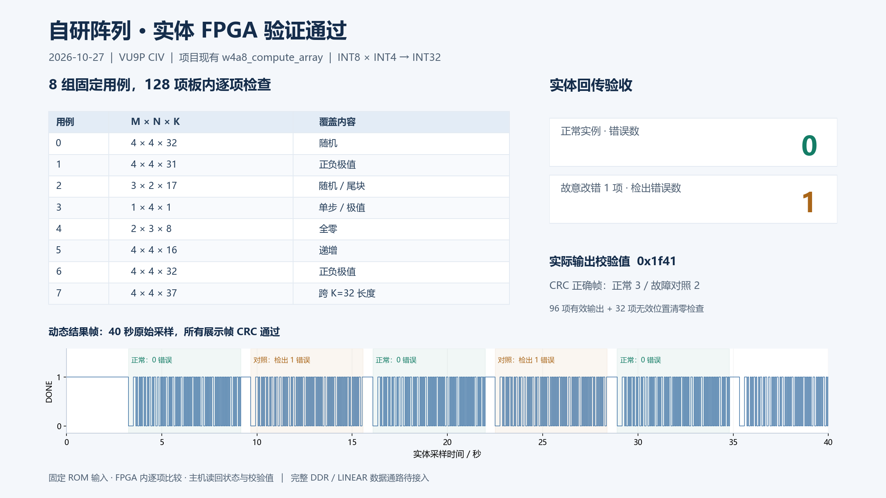

# 板级结果及复现范围

## 自研阵列实测（2026-10-27）

运行项目现有 `w4a8_compute_array`、`mac_pe`，顶层为 `array_selftest_top`。正式目标 `xcvu9p_CIV-flgb2104-2-i`，IDCODE `0x04b35093`。标准 VU9P 的 `0x04b31093` 与这次板卡参考镜像不匹配，不能手工改 ID 或关闭 CRC 代替正确器件构建。

链路：固定 ROM 输入 → 自研 4×4 整数阵列 → 板内逐项比较及实际输出校验值 → DONE 专用信号 → 管理侧采样与主机解码。

| 结果 | 实测 |
| --- | --- |
| 输入 | 8 组，随机/极值/零/尾块/K37，含推进暂停 |
| 比较 | 128 项，96 有效输出 + 32 无效位置清零，错误数 0 |
| 实际输出 checksum | 0x1f41 |
| 独立对照 | 第一组第一项预期值翻转 1 位，检出 1 项不一致 |
| 回传 | 3 个正常帧、2 个对照帧，CRC 正确；40 秒、72,184 个采样点 |
| 结束 | 恢复参考配置、执行复位，参考控制状态 0x30；8 个 DMA 通道空闲 |

状态帧重复发送同一次 8 组计算的结果，不是 5 次独立计算。比较在 FPGA 内完成，主机未逐项读取全部原始输出。测试镜像有两份独立 16-PE 阵列，共 32 DSP，还含输入和比较电路，不能作为单份阵列资源。



原始 CSV、解码 JSON、加载/恢复日志在 [evidence](../reports/array_bist_20261027/evidence)。历史构建报告中的 `self_rtl_on_fpga=false` 表示当时只完成构建；物理运行结果 `physical_validation_result.json` 的对应状态为 true，二者属于不同阶段。

## 本实验没有覆盖的路径

内部振荡器除以 8，名义约 6.25 MHz；普通 I/O 端口为 0。没有计算侧 DDR、GT/Aurora、外部用户时钟或主机任务端点。它绕开了 DDR 校准与连线、外部时钟/复位/CDC、AXI 存储与控制互连、完整 LINEAR 量化后处理及全部结果回传。

因此它能证明选定器件上所用阵列逻辑实际工作，不能证明完整 shell、所有外部接口、目标运行频率或完整加速器可用。没有物理 tokens/s、功耗或模型精度结论。

同日的既有参考镜像另完成 4 KiB DDR 回读、896 块参考矩阵计算，以及 19 次项目数据整数任务和主机尺度合并后的 109 个输出。它说明当时该参考配置对应的路径工作过；计算核属于参考镜像。见 [参考后端记录](../reports/reference_board_20261027/结果说明.md)。

## 离线重放

```text
python scripts/verify_board_evidence.py
```

会重新解码原始采样、核对源代码身份和压缩镜像哈希，不连接任何硬件。历史原始报告使用本地交付包的目录和绝对路径，仓库内导航以本说明为准。

## 保存的可加载镜像

`artifacts/array_bist_20261027/array_selftest_c6.bit.gz` 是当时实际加载镜像的无损压缩版，解压后 80,159,236 字节，SHA256：

```text
f995dafc0657c1df844b74f9908efa58c1ddd209a9ed03a5a7511feb78c3487c
```

它只适用于匹配的器件和本实验，不能作为 DDR/Aurora shell。不是 Flash 镜像，运行结束后也不会永久留在 FPGA 中。

## 实体复现前提

1. 确认与原实验相同的管理固件和器件，明确选择单卡、单片计算 FPGA；本次固定 PCI `0000:84:00.0`、chipsel=1。
2. 管理驱动和加载流程可用，确认目标未被其他任务占用。
3. 准备本地已验证的恢复镜像，SHA256 为 `59358c612a7075ce1c8433ef26fe9bf4d5a7d30defdf501579195ce9baf2b984`。该既有参考镜像不包含在仓库中。
4. 根据实际服务器更新 `run_physical.sh` 中恢复镜像、Python 和工具路径。保留型号、哈希、占用检查、采样解码和失败恢复。

将 `experiments/array_bist_20261027` 的加载/采样 C、Python、Shell 文件放在独立服务器工作目录，将保存镜像解压命名为 `array.bit`，再运行：

```text
bash run_physical.sh array f995dafc0657c1df844b74f9908efa58c1ddd209a9ed03a5a7511feb78c3487c
```

这条命令会改变选定计算 FPGA 的易失配置、使用管理 DDR 暂存镜像，并在退出时恢复参考配置。它不写持久化 Flash。缺少匹配环境时只做离线重放。
