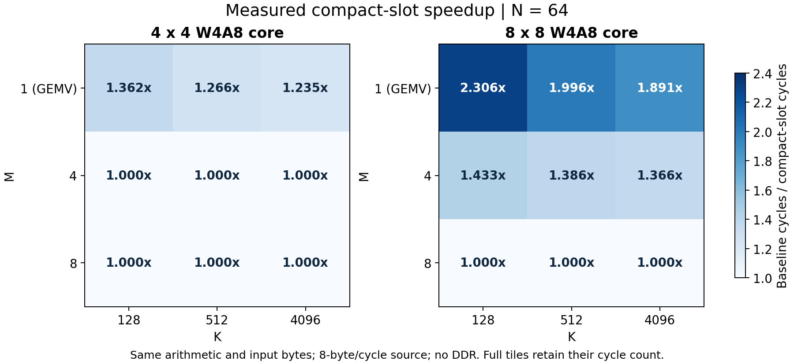

# 计算核心精进、结构接入与三方微基准

> 历史阶段记录：当前实现与归一化对照以 [compute_round2.md](compute_round2.md) 为准。以下保留第一轮结果。

日期：2026-10-25。工程：E:/speed-up，基于 3b0a5d5 的未提交工作区；这是当前源码实际执行的结果。

本轮已实现紧凑有效槽位调度与 Attention 内存 Q 接入，并实际运行两个固定版本的上游计算核心。单行任务开销明显下降，但三方原生带宽、位宽和硬件规模不同，表中数据用于定位计算结构差距，不能据此宣称同资源、同精度或板级速度领先。

## 1. 已落地的计算优化

`rtl/w4a8_wave.sv` 新增默认开启的 COMPACT_SLOTS=1。初始化 Y、SAVE_G、scale 后处理的 issue/retire、结果输出跳过无效行列，保留原物理 PE/RAM 编址。完整阵列的执行顺序不变，尾块只访问有效位置。旧完整源码保存为 `tb/baselines/w4a8_wave_precompact.sv`；同一份当前源码用 COMPACT_SLOTS=0/1 配对比较。

| 阵列 | M×N×K | 原版周期 | 新版周期 | 减少 | 加速比 |
|---|---|---|---|---|---|
| 4×4 | 1×13×96 | 1,003 | 697 | 30.51% | 1.439× |
| 8×8 | 1×13×96 | 1,139 | 449 | 60.58% | 2.537× |
| 4×4 | 1×64×4096 | 132,033 | 106,881 | 19.05% | 1.235× |
| 8×8 | 1×64×4096 | 124,577 | 65,889 | 47.11% | 1.891× |
| 8×8 | 4×64×4096 | 125,217 | 91,681 | 26.78% | 1.366× |
| 8×8 | 8×64×4096 | 127,007 | 127,007 | 0.00% | 1.000× |



以 8×8、M1/N13/K96 为例，group 后处理 issue 数从 384 降到 39；M1/N64/K4096 从 65,536 降到 8,192。每组部分和、最终数值、有效 MAC、输入字节、阵列计算/推进计数均逐项相同。满 8 行任务未获得此优化的收益，符合只删除无效位置的设计。

这次没有把 INT4 改为多乘积打包，没有增加单 PE 每拍乘积，也没有实现 K 维 GEMV 重映射。当前每 PE 每拍仍一个乘积，4×4/8×8 的物理峰值仍为 16/64 MAC/拍。

## 2. 结构接入与 ABI v3

新增 `rtl/attention_q_dma.sv`，并把它接入真实 `attention_kv_top`、统一 source manifest 和软件描述符。q_source=0 使用旧主机流，Q 内存字段必须全零；q_source=1 从 q_addr 读取 dimension 个紧凑 signed INT8 字节，从 qs_addr 读取 ceil(dimension/GROUP_SIZE) 个 little-endian UQ4.12 scale。q_bytes/qs_bytes 描述分配区容量。

Q/scale 每次查询只预取一次。QLOAD 独占 AR/R；读响应全部排空后才能转交 KV，随后本地缓冲按反压输出 Q/scale/last。错误阻止计算启动；所有输出仍等 B response 才完成。访问前校验范围、容量、回绕、Q/scale 互斥和与 Y 的重叠。内存模式忽略主机 Q 噪声；连续任务、复位恢复、读写错误均已测试。

该接口消费已经量化的 Q。LINEAR 的 Q16.16 投影结果尚不能自动直接接入：自动量化、Q/K/V/O 任务图、RMSNorm、RoPE、残差和完整模型执行链仍待完成。默认容量仍是 Attention dimension≤64、tokens≤16，单活动任务顺序执行。

## 3. 实际运行上游核心的方法

统一数学任务为 M∈{1,4,8}、N=64、K∈{128,512,4096}，共 9 形状。固定随机种子，A/W∈{-1,0,1}、所有数学 scale=1。独立 Python 整数点积生成期望值，再编码为各自原生格式；输出逐项校验，浮点正负零按数学等价接受，执行 MAC 必须恰为 M×N×K。这组小整数避免溢出和跨格式舍入差异，用于周期结构实验，不代表真实量化模型精度。

| 项目 | 实际 DUT 与供数边界 | 说明 |
|---|---|---|
| 本工程 | 4×4/8×8 w4a8_wave，TILE_K=8/GROUP_SIZE=32；8 byte/拍 source，输入尽快供给，输出始终 ready | 包含加载、group 后处理、排空、输出；双缓冲/A reuse 保持生产配置；无 AXI/DDR |
| openTPU | 原始 otpu_mxu，D128/MCOLS4/ACT_ROWS8/DEPTH64/LANES8；IMPL2 systolic，另测 IMPL0 tree | ACT 已预装；128 byte 权重响应/拍、scale 独立 1 拍响应、TMEM 总是授权；用上游自带 generic DSP/RAM 周期模型 |
| llama-fpga | 固定版本 KV260 生成 Verilog 内的 MulAddSGNew，原文提取递归依赖共 10 模块、128 路 FP16 | 在权重反量化之后注入 FP16；实际 FP IP 模型，含归约和 FP32 累积；每行顺序执行 GEMV；不含 DDR/反量化器 |

openTPU 每种实现实际测 INT8 unit scale、signed INT4 unit scale 和 E2M1 FP4 三种格式；M=1 用其原生 PAIR，M=8 用原生 ACT replay。PAIR 的奇数 K block 会补齐 scale pair 到 8 字节边界。XSim 兼容修改仅把 mx_go 的 net 声明提前，保持连续赋值和算法/流水不变；公共复位保持 100 拍以排空无复位的元数据延迟线。没有重写上游计算公式。

llama-fpga 原始 XCI 配置在私有项目副本中用 Vivado 2025.2 升级，调用真实 floating_point_v7_1_21 仿真模型；128 路乘法之后保留原 FP16 加法、FP32 转换/归约/累积和 FP16 输出。未使用自写乘法/加法替代器。独立 IP 配置与来源摘要见证据 JSON。计算核心来自 [openTPU MXU](https://github.com/FeSens/openTPU/blob/810632e2e1d4961575a3c6f8f194abc8fc3f8fd3/rtl/mxu/otpu_mxu.sv)、[llama-fpga MulAddSGNew](https://github.com/adamgallas/llama-fpga/blob/bdd90206675594ab6b710a32d5319c68a58d9c36/scala/src/main/scala/top/MulAddSGNew.scala) 及 [KV260 生成 RTL](https://github.com/adamgallas/llama-fpga/blob/bdd90206675594ab6b710a32d5319c68a58d9c36/kv260/kv260_vivado/kv260_vivado.srcs/sources_1/imports/EdgeLLM/DataPath_xN.v)。

本工程周期计数覆盖 start 后完整内核 busy 到完成；openTPU 从命令 start 到 done；llama-fpga 从首行配置/输入开始到末行最后结果。复位和 case 解析不计入，llama-fpga 行间配置计入。本实验提供各自入口下连续供数的周期；供数位宽和输入预装成本未归一，不能当作相同带宽的公平排名。

| 核心（原生入口） | M×N×K | 实测周期 | 有效 MAC/拍 | 物理乘积峰值/拍 | 峰值利用率 |
|---|---|---|---|---|---|
| speed-up | 1×64×4096 | 65,889 | 3.979 | 64 | 6.22% |
| openTPU | 1×64×4096 | 1,090 | 240.499 | 512 | 46.97% |
| llama-fpga | 1×64×4096 | 2,147 | 122.098 | 128 | 95.39% |
| speed-up | 8×64×4096 | 127,007 | 16.512 | 64 | 25.80% |
| openTPU | 8×64×4096 | 4,176 | 502.192 | 512 | 98.08% |
| llama-fpga | 8×64×4096 | 17,183 | 122.048 | 128 | 95.35% |

有效 MAC/拍=M×N×K÷总周期；一次乘加按一个 MAC 计。物理峰值表示每拍可发出的乘积项，与数值类型一起解释；FP16、W4A8、INT4/FP4 并非相同算术成本。这里不给两个上游强行套用 100 MHz，也不推导其未实测 DSP 效率。完整 99 行原始配置统计见 `build/compute_experiments/three_core_comparison.csv`，本工程 108 组配对数据见 `build/compute_experiments/comparison.csv`。

## 4. 资源效率与实现证据

以下四核均在 xcvu9p-flga2104-2L-e、10 ns OOC 约束下实际完成 synth/place/route，setup/hold 非负、路由错误为 0；没有 latch 或 blackbox。数值是当前核心资源，包含核心内的 scale 后处理，不能用整个 llm_top 的 DSP 作为分母。

| 核心 | LUT | FF | DSP | BRAM36 等价 | WNS ns | WHS ns |
|---|---|---|---|---|---|---|
| core_4x4_compact0 | 2601 | 2436 | 21 | 6.0 | 4.178 | 0.011 |
| core_4x4_compact1 | 2744 | 2438 | 21 | 6.0 | 4.286 | 0.011 |
| core_8x8_compact0 | 4237 | 3909 | 69 | 10.0 | 2.949 | 0.011 |
| core_8x8_compact1 | 4356 | 3910 | 69 | 10.0 | 4.389 | 0.011 |

紧凑调度的 DSP 和 BRAM 数量保持一致；4×4 LUT 增加 143、8×8 增加 119，是换取尾块开销减少的控制成本。正 WNS 仅表示此约束通过，不据此换算未经重跑验证的最高频率。

| 本工程新版核 | M×N×K | 有效 MAC/拍 | 有效 MAC/(拍·DSP) | 峰值 MAC/(拍·DSP) |
|---|---|---|---|---|
| core_4x4_compact1 | 1×64×4096 | 2.4527 | 0.11679 | 0.76190 |
| core_4x4_compact1 | 8×64×4096 | 7.9188 | 0.37708 | 0.76190 |
| core_8x8_compact1 | 1×64×4096 | 3.9786 | 0.05766 | 0.92754 |
| core_8x8_compact1 | 8×64×4096 | 16.5121 | 0.23931 | 0.92754 |

在同一长 K 单行任务里，4×4 的有效 MAC/(拍·DSP) 约为 0.11679，高于 8×8 的 0.05766；8×8 的绝对周期更少，但尚未充分利用增加的 PE 行。资源效率也支持优先重做 GEMV 映射。

当前 llm_top 的完整物理实现：WNS=+0.159 ns、WHS=+0.011 ns，路由 58,238/58,238、错误 0。结构改变后旧布局复用失败，因此本轮使用校验过源码的 synthesis checkpoint 重新完整放置/布线；失败日志保留，最终数据来自通过的这次运行。当前仍是内部 OOC，尚无板卡 pin/外部 I/O、DDR/PCIe/CDC 或板上频率验证。

## 5. 验证与复现

- 软件 20 项测试通过。
- 主系统 12 个配置共 261 条完成记录通过，逐字节核对 5,570,560 字节；包括旧 Q 流、新内存 Q、混合引擎、32/64 位地址、group32/12/4/3、负例、反压、读写错误与恢复。
- 4×4/8×8 × dense/compact：4 个配置各 61 个任务，通过原整数参考的 group psum 与输出检查，配对 108 组正常任务。
- 额外 2×3/TILE_K5/GROUP12 紧凑核通过 52 个任务，覆盖非 2 幂参数、奇 K、停顿和复位；Q DMA 单元覆盖 group32/3/1、dimension1/9/64、未对齐字节、精确读数、反压、首个 scale/Q 读错误和未完成读时的复位。
- openTPU IMPL2/IMPL0 各 27 个实际数值实验通过；llama-fpga 9 个通过。正式入口从哈希校验的原始源码重建并复跑，未使用 README 推算代替实际执行。

```powershell
Set-Location E:\speed-up
python .\scripts\project.py test
python .\scripts\project.py implement
python .\scripts\project.py status
python .\model\w4a8_reference.py
python .\model\w4a8_systolic_vectors.py
python .\scripts\run_compute_experiments.py --implement
python .\scripts\test_compact_slots.py
python .\scripts\test_q_dma.py
python .\experiments\compute_upstream\run_upstream_compute.py
python .\experiments\compute_upstream\run_upstream_compute.py --engine openTPU --impl 0
```

上游入口首次联网下载固定提交，仅接受 sources.json 中的 Git blob 和 SHA256；可用 --source-cache 提供离线原始文件。首次 llama-fpga 会生成/编译实际浮点 IP，耗时明显长于整数核。构建目录保存输入哈希、期望数据、周期 CSV、编译与数值日志；PASS 同时要求成功标记、无 Fatal/ERROR 和完整用例数。

## 6. 实验确定的下一步

这次 8×8 的 M1/N64/K4096 有效阵列 MAC/advance 仍为 5.565，满 M8 为 44.522；8×8 理论峰值是 64。group32 每组仍要走物理阵列 14 拍排空，单行又只用一个 PE 行。删除无效后处理位置后，GEMV 映射和 group 接缝仍是主要差距。

下一步优先做单行 K 维拆分/跨输出通道映射，保持 group 内精确部分和与既有 rounding/saturation；随后缩短按有效行列的波前排空，减少 SAVE_G/scale 的串行占用。INT4 多乘积打包应在可证明的符号/进位隔离与完整极值测试后独立测量。结构上先接投影结果的自动量化及 Q/KV/O 阶段图，再形成带 RMSNorm/RoPE/残差的完整 Block。尚未完成的部分均未计入这次性能收益。
